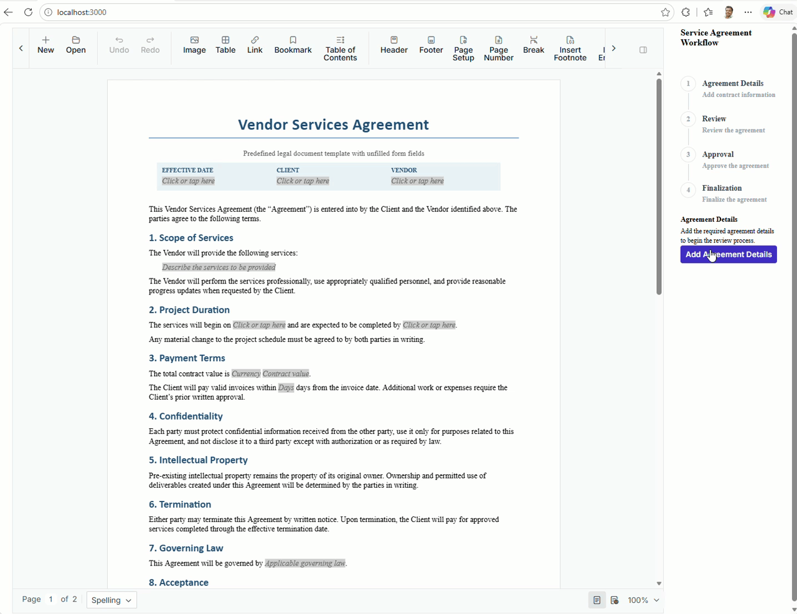
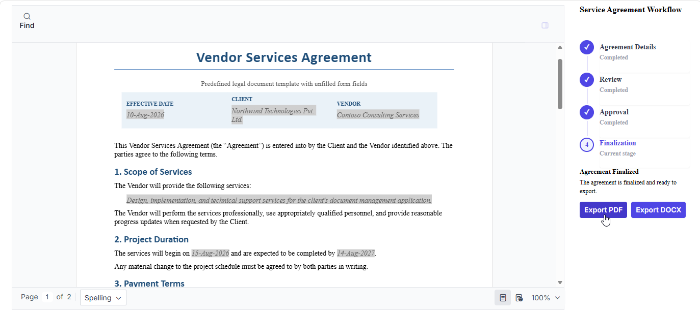

# Syncfusion® React DOCX Editor – Service Agreement Workflow

## Introduction

This sample demonstrates a service agreement workflow built with the [Syncfusion® React DOCX Editor](https://www.syncfusion.com/docx-editor-sdk/react-docx-editor?utm_source=github&utm_medium=listing&utm_campaign=github-github-documenteditor-examples). It lets users populate a predefined agreement, review changes, move through an approval stage, and export the finalized document.

## Project Features

- Populate agreement fields in a predefined service agreement document.
- Review the agreement with tracked changes enabled.
- Switch to an approval stage and inspect outstanding revisions.
- Prevent finalization while tracked revisions remain unresolved.
- Finalize the document in read-only mode.
- Export the finalized agreement as PDF or DOCX.

## Demo

<p align="center">
  
</p>

The screenshot below shows the final stage of the workflow, where the document can be exported in either PDF or DOCX format.
<p align="center">
  
</p>

## How to Run the Sample

This archive contains a React client only; it does not include a custom backend project. The sample uses the Syncfusion-hosted document editor service configured in `src/index.jsx`.

### Prerequisites

- Node.js and npm.
- Internet access to retrieve npm packages and use the configured Syncfusion document editor service.

### Run locally

1. Extract the project archive and open a terminal in the project root (the directory containing `package.json`).
2. Install the dependencies:

   ```bash
   npm install
   ```

3. Start the development server:

   ```bash
   npm start
   ```

4. Open the local URL printed in the terminal.

### Service URL configuration

The document editor service URL is assigned to `hostUrl` in `src/index.jsx` and passed to the editor through its `serviceUrl` property. The PDF export handler also uses this URL with the `Export` route.

To use a different document-processing service, update `hostUrl` to the appropriate service base URL and confirm that the service supports the operations required by the editor and PDF export. Do not add API keys or other secrets to client-side code.

## APIs Used

| API / Endpoint | HTTP Method | Purpose |
|---|---|---|
| `https://document.syncfusion.com/web-services/docx-editor/api/documenteditor/Export` | `POST` | Converts the editor's serialized document content to PDF for download. The request sends the document content, file name, and export format. |

## Resources

- **Product page:** [Syncfusion® React DOCX Editor](https://www.syncfusion.com/docx-editor-sdk/react-docx-editor?utm_source=github&utm_medium=listing&utm_campaign=github-github-documenteditor-examples)
- **Documentation:** [Syncfusion® React DOCX Editor – Documentation](https://help.syncfusion.com/document-processing/word/word-processor/react/overview?utm_source=github&utm_medium=listing&utm_campaign=github-github-documenteditor-examples)
- **Online demo:** [Syncfusion® React DOCX Editor – Online demo](https://document.syncfusion.com/demos/docx-editor/react/#/tailwind3/document-editor/default?utm_source=github&utm_medium=listing&utm_campaign=github-github-documenteditor-examples)

## Support and feedback

For questions, contact the [Syncfusion® support team](https://support.syncfusion.com/?utm_source=github&utm_medium=listing&utm_campaign=github-github-documenteditor-examples) or post in the [community forums](https://www.syncfusion.com/forums?utm_source=github&utm_medium=listing&utm_campaign=github-github-documenteditor-examples).

Request a new feature through the [Syncfusion® feedback portal](https://www.syncfusion.com/feedback?utm_source=github&utm_medium=listing&utm_campaign=github-github-documenteditor-examples).

## License

Syncfusion DOCX Editor is commercial software. Use of Syncfusion licensed software is subject to the terms and conditions of the [Syncfusion EULA](https://www.syncfusion.com/license/studio/syncfusion_essential_studio_eula.pdf?utm_source=github&utm_medium=listing&utm_campaign=github-github-documenteditor-examples). Review the EULA to determine the license requirements applicable to your use. You can [purchase a license](https://www.syncfusion.com/sales/products?utm_source=github&utm_medium=listing&utm_campaign=github-github-documenteditor-examples) or [start a free 30-day trial](https://www.syncfusion.com/account/manage-trials/start-trials?utm_source=github&utm_medium=listing&utm_campaign=github-github-documenteditor-examples).
